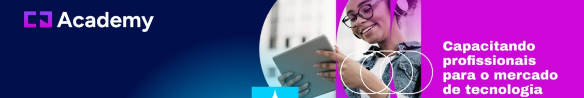

# QaCoders Academy

**Formando profissionais de Qualidade de Software prontos para o mercado**

&nbsp;

---

## Sobre nós

A **QaCoders Academy** é uma comunidade e escola dedicada à formação de profissionais de **Qualidade de Software (QA)**. Nosso objetivo é capacitar pessoas com conhecimento prático em testes manuais e automatizados, boas práticas de engenharia de qualidade e as ferramentas mais usadas no mercado.

Aqui você encontra projetos práticos, materiais de estudo e desafios que ajudam a construir uma base sólida em testes de software.

## ⚙️ Tecnologias Usadas

### Frontend

| Tecnologia | Descrição |
|------------|-----------|
|  | Biblioteca para construção da UI |
|  | Framework React (App Router) |
|  | Tipagem estática |
|  | Estilização utilitária |
|  | Validação de schemas de formulário |
|  | Padronização e qualidade de código |
|  | Gerenciador de pacotes |
|  | Containerização |
|  | Design da UI |

### Backend

| Tecnologia | Descrição |
|------------|-----------|
|  | Framework backend progressivo em Node.js |
|  | Tipagem estática |
|  | Ambiente de execução |
|  | Banco de dados via Mongoose |
|  | Autenticação com tokens |
|  | Documentação da API |
|  | Testes automatizados |
|  | Containerização |

### QA & Testes

| Tecnologia | Descrição |
|------------|-----------|
|  | Testes de API |
|  | Documentação e gestão de testes |
|  | Automação de testes |

## Como participar

1. Explore nossos [repositórios](https://github.com/orgs/qacoders-academy/repositories)
2. Acompanhe nossos projetos e desafios
3. Conecte-se conosco no [LinkedIn](https://www.linkedin.com/company/qa-coders-academy/)

---

**Feito com 💜 pela comunidade QaCoders Academy**

